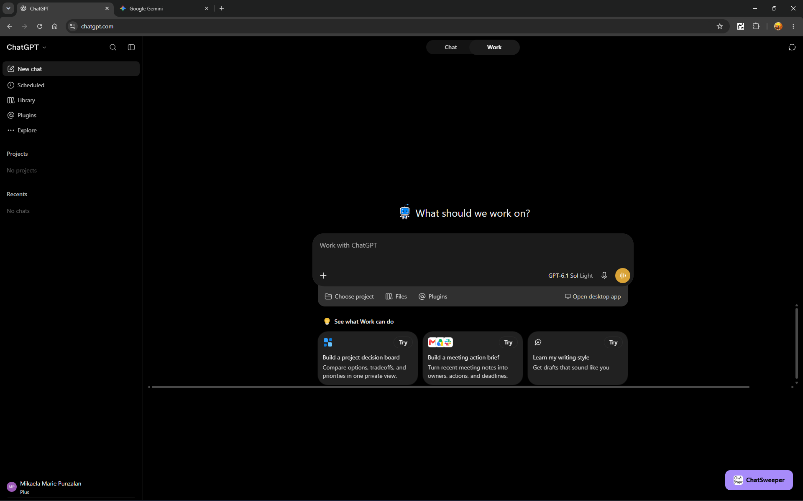
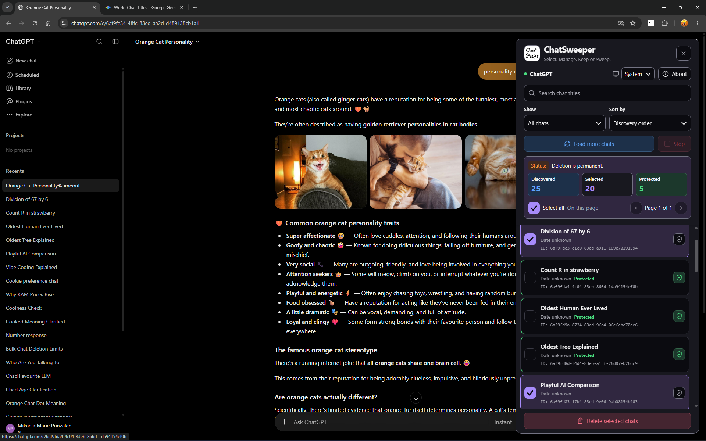
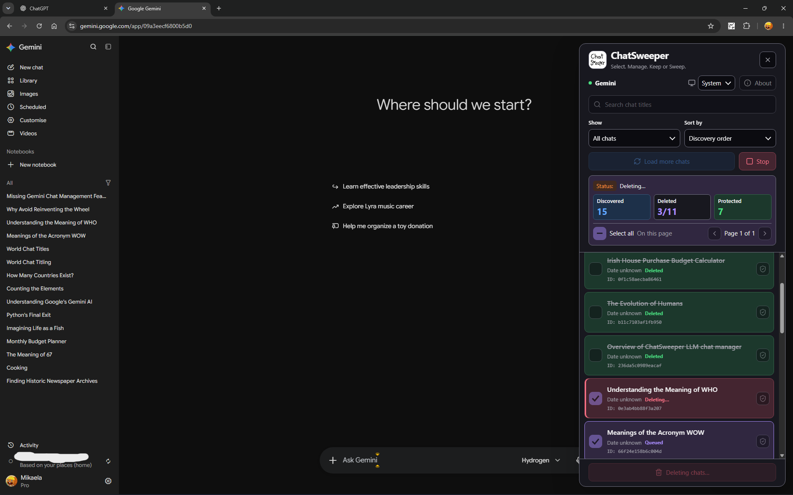
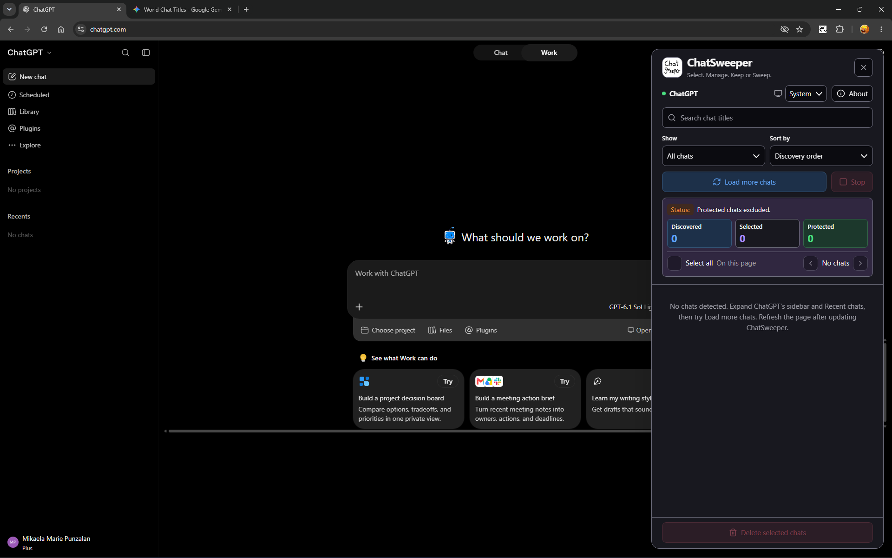
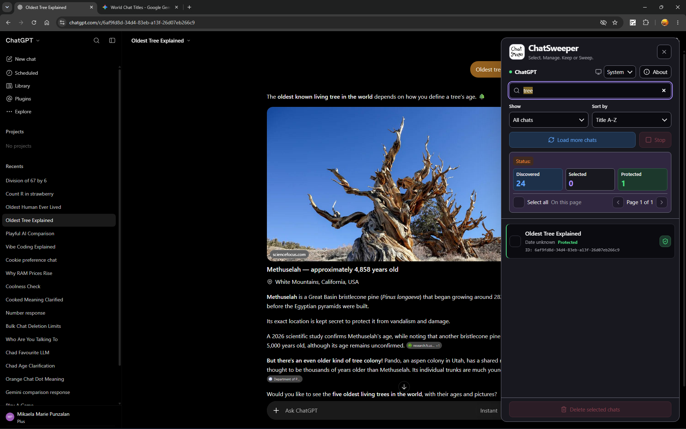
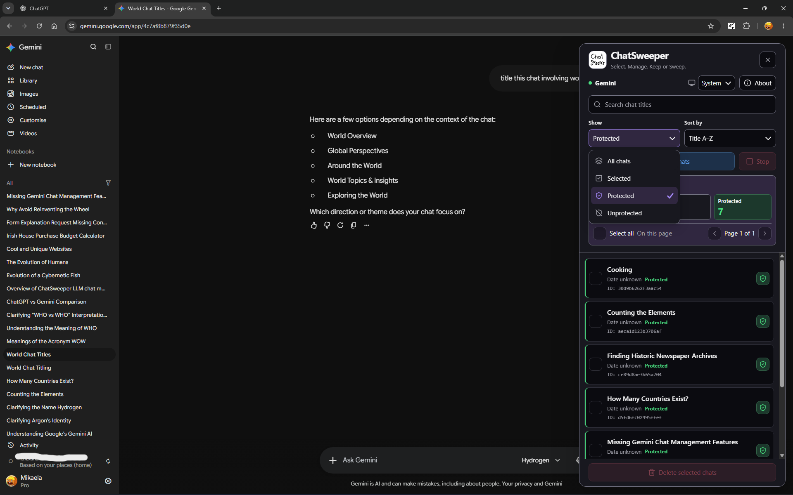
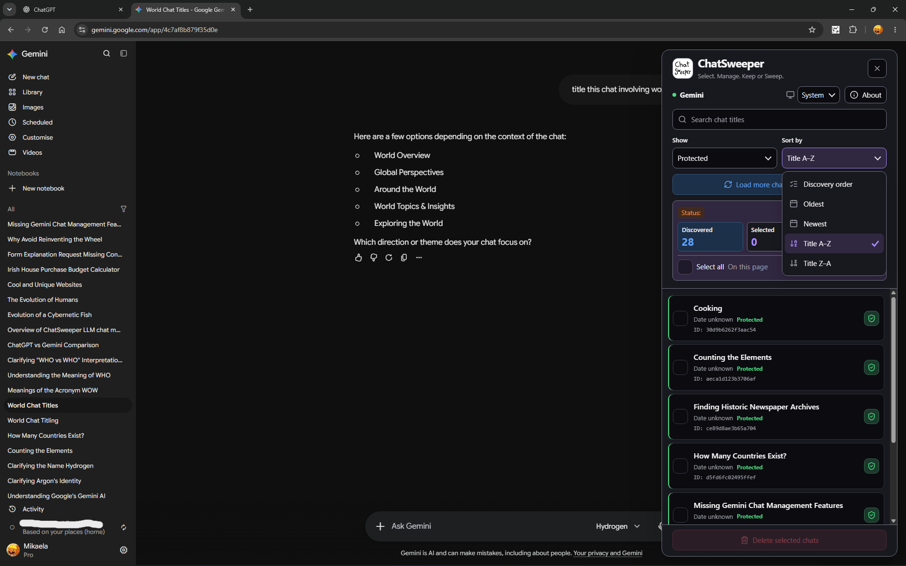

<div align="center">
  
  <h1>ChatSweeper</h1>
  <p><strong>v0.1.0</strong> · Early release</p>
  <p><strong>Select. Manage. Keep or Sweep.</strong></p>
  <p>Find, organise and delete Gemini and ChatGPT chats from one panel.</p>
  <p><a href="#gallery">Gallery</a> · <a href="#install">Install</a> · <a href="docs/USAGE.md">Usage</a> · <a href="docs/DEVELOPMENT.md">Development</a> · <a href="LICENSE">GPLv3</a></p>
</div>

## Features

Dark mode and the main chat management features are ready for this early release. Light mode is still being refined.

- **Discover** : count sidebar chats and check for new entries before loading older history. View 50 chats per page.
- **Select** : choose individual chats or select the current page. Selections carry across pages.
- **Search and show** — search full titles and filter by protection or selection.
- **Sort** : title A–Z/Z–A, discovery order, or newest/oldest when dates are available.
- **Protect** : save chats you want to keep. Protection persists across reloads and prevents ChatSweeper from deleting those chats.
- **Delete** : review the selected count in Status, then use **Delete selected chats** to start permanent deletion. The list follows the active row, displays chat IDs and marks protected chats as skipped. Your normal chat list returns automatically when deletion finishes or stops.
- **Appearance** : shadcn/ui, Tailwind CSS and Lucide icons, with automatic system detection and saved System / Light / Dark themes.
- **Privacy** : no analytics, private chat API calls or external data collection. Only protected IDs and theme preferences are saved locally.

## Gallery

**Panel closed**

<a href="docs/images/closed-chatsweeper.png"></a>

**ChatGPT**

<a href="docs/images/chatgpt-chatsweeper.png"></a>

**Gemini**

<a href="docs/images/gemini-chatsweeper.png"></a>

<details>
<summary>More examples: search, filters, sorting etc.</summary>

**No chats detected**

<a href="docs/images/no-chats.png"></a>

**Search chat titles**

<a href="docs/images/search-filter.png"></a>

**Show**

<a href="docs/images/show-filter.png"></a>

**Sort**

<a href="docs/images/sort-filter.png"></a>

</details>

## Install

No build step or API key is needed to use the included extension.

1. Extract the repository ZIP, source ZIP or installable `chatsweeper.zip`.
2. Open `chrome://extensions` and enable `Developer mode`.
3. Click `Load unpacked` and select the `extension/` folder below.
4. Refresh [Gemini](https://gemini.google.com/app) or [ChatGPT](https://chatgpt.com/), sign in and expand the chat sidebar.
5. Open ChatSweeper with its corner button or the browser's extension icon.

| Download | Folder to select |
| --- | --- |
| Repository or source ZIP | The `extension/` folder inside the extracted project |
| Installable `chatsweeper.zip` | The extracted folder containing `manifest.json` |

To update, replace the files in the same loaded folder, click `Reload` on the extension card, then refresh your chat tabs. Existing protected-chat settings are preserved.

**Browsers** : `Chrome` is locally tested; other desktop `Chromium browsers` are expected to work. `Firefox` is unsupported. Access is limited to Gemini, ChatGPT and ChatGPT's legacy hostname, with `activeTab` and `storage` permissions.

## Limitations

- Counts cover sidebar chats discovered in the current tab.
- Dates depend on site metadata. Unknown dates sort last; without readable dates, discovery order is kept.
- Deletion relies on the sites' English menus and page changes. Server-side completion is not independently confirmed.
- Protection covers ChatSweeper actions only. Project-folder deletion and custom date ranges are unavailable.

**Signed-in discovery and deletion have been confirmed in user testing on both sites.** Automated checks use simulated pages; the updated deletion flow still needs live testing. Try a disposable chat first. [Full usage and limitations →](docs/USAGE.md)

## Build & test

Development requires Node.js 22+ and npm, Chrome/Chromium for browser tests, and Python 3 for ZIP packaging.

```sh
npm ci
npm run typecheck
npm run build
npm test
npm run package
```

React/shadcn markup, Tailwind CSS and Lucide icons are compiled at build time and bundled locally. [Development details →](docs/DEVELOPMENT.md)

## License & credits

**© 2026 Mikaela Marie Punzalan** · [@okmikaelaok](https://github.com/okmikaelaok)

Licensed under **GNU General Public License v3 only (GPLv3)**. See [LICENSE](LICENSE), [NOTICE](NOTICE) and [third-party attribution](THIRD_PARTY_NOTICES.md).

Independent project; not affiliated with Google or OpenAI.
